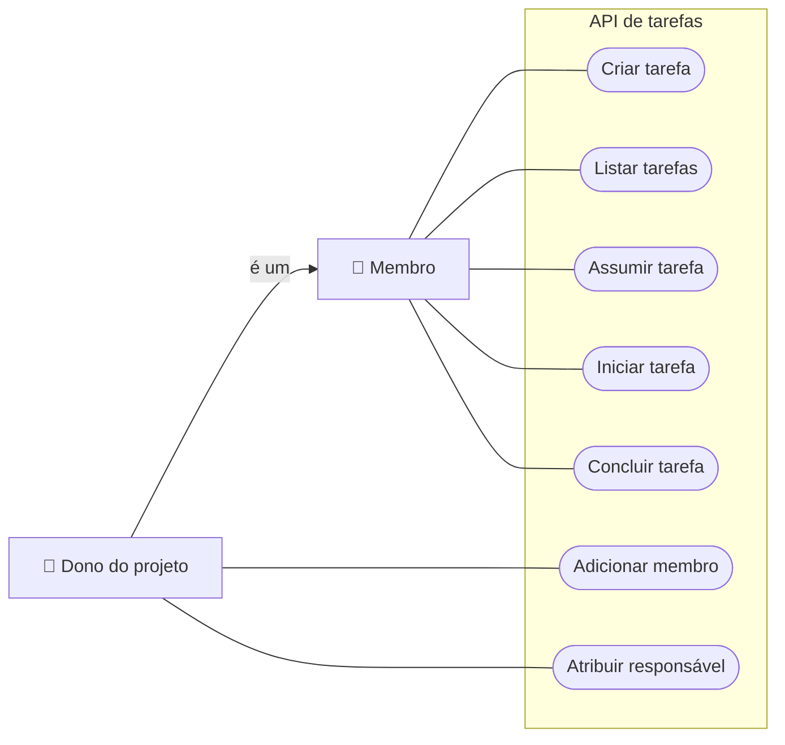
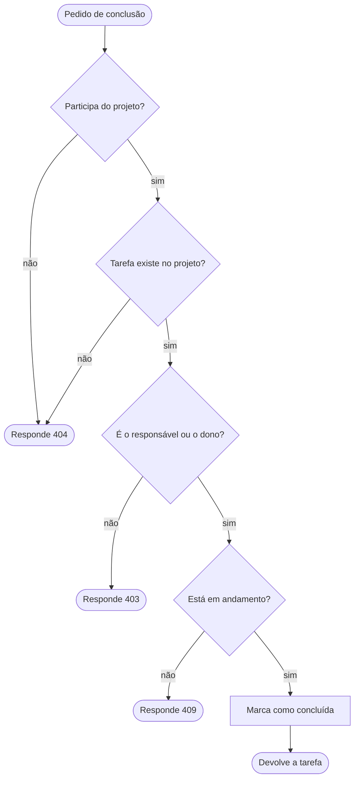
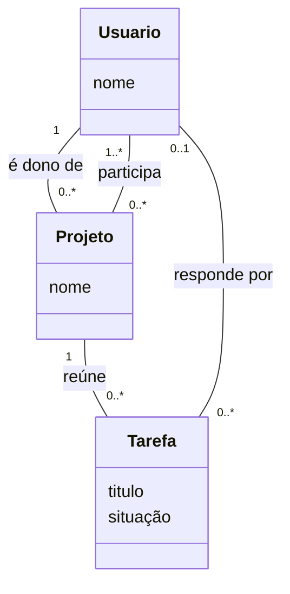

# Especificação de Requisitos

## 📋 O que são requisitos

Requisitos descrevem **o que** um sistema deve fazer e **sob quais restrições** ele deve operar. Eles são, em geral, o produto mais difícil de acertar em um projeto de software: requisitos errados ou incompletos custam caro para corrigir quanto mais tarde forem descobertos, e um requisito mal-entendido pode comprometer um projeto mesmo quando o código é bem feito.

Requisitos costumam existir em diferentes níveis de abstração, e diferentes públicos leem diferentes níveis:

* **Requisitos de usuário**: enunciados em linguagem natural (e às vezes diagramas), descrevendo os serviços que o sistema deve fornecer e as restrições sob as quais deve operar, voltados a clientes e usuários finais.
* **Requisitos de sistema**: descrições mais detalhadas das funções, serviços e restrições do sistema, servindo como contrato entre cliente e desenvolvedores.

## 🏷️ Classificação dos requisitos

### Requisitos funcionais

Descrevem serviços que o sistema deve fornecer, como o sistema deve reagir a entradas específicas, e como deve se comportar em situações particulares. Podem também declarar explicitamente o que o sistema **não** deve fazer.

*Exemplo:* "O sistema deve permitir que o usuário redefina sua senha por e-mail."

### Requisitos não funcionais

Restringem os serviços ou funções oferecidos pelo sistema — não dizem o que o sistema faz, mas **como** ele deve fazer. Costumam ser classificados em:

| Categoria | Exemplos |
|---|---|
| **Requisitos de produto** | Desempenho, usabilidade, confiabilidade, segurança, portabilidade |
| **Requisitos organizacionais** | Padrões de processo da empresa, políticas de segurança da informação |
| **Requisitos externos** | Regulamentações legais (LGPD, GDPR), interoperabilidade com sistemas de terceiros |

*Exemplo:* "O sistema deve responder a 95% das requisições em menos de 300ms sob carga de 1000 requisições/segundo."

!!! warning "Requisitos não funcionais são frequentemente subestimados"
    É comum um projeto ter uma lista extensa de requisitos funcionais e apenas uma frase vaga sobre desempenho ou segurança. Na prática, requisitos não funcionais mal especificados são uma das causas mais comuns de retrabalho tardio e caro — descobrir que o sistema não escala, ou que não atende a uma exigência de conformidade, depois de já estar em produção.

## 🔎 A engenharia de requisitos

A engenharia de requisitos é o processo estruturado de descobrir, analisar, documentar e verificar esses serviços e restrições. Ela se organiza em três atividades principais, que se repetem ao longo do projeto em vez de acontecer uma única vez:

1. **Elicitação e análise** — descobrir os requisitos pela interação com stakeholders, documentos e análise do domínio. Inclui:
    * descoberta dos requisitos;
    * classificação e organização, agrupando requisitos relacionados;
    * priorização e negociação, para resolver conflitos e decidir o que entra em cada versão;
    * registro do que foi levantado, para alimentar a próxima rodada.
2. **Especificação** — documentar os requisitos de forma clara, verificável e (idealmente) testável.
3. **Validação** — checar se os requisitos representam o que o cliente de fato precisa.

### Elicitação: como descobrir requisitos

A elicitação de requisitos combina várias técnicas, cada uma com pontos fortes e limitações:

=== "Entrevistas"
    Conversas estruturadas ou semiestruturadas com stakeholders. Boas para explorar contexto e motivação, mas dependem da capacidade do entrevistado de articular necessidades que muitas vezes são implícitas.

=== "Observação (etnografia)"
    Observar usuários realizando seu trabalho real revela necessidades que eles não saberiam verbalizar — hábitos, atalhos informais, exceções ao processo "oficial".

=== "Workshops e dinâmicas colaborativas"
    Sessões com múltiplos stakeholders (ex: *Event Storming*, de Alberto Brandolini; *Story Mapping*, de Jeff Patton) ajudam a alinhar visões divergentes e descobrir requisitos nas lacunas entre departamentos.

=== "Protótipos"
    Mostrar algo tangível — mesmo que simples — costuma gerar feedback muito mais preciso do que discutir requisitos de forma puramente verbal ou textual.

### Prototipação

Um **protótipo** é uma versão parcial e barata do sistema, feita para responder a uma dúvida antes de construí-lo. Ele varia em três aspectos:

| Aspecto | De um lado | Do outro |
|---|---|---|
| **Fidelidade** | *Baixa*: rascunho no papel ou *wireframe*, sem cores nem dados reais | *Alta*: aparência e navegação próximas das finais |
| **Alcance** | *Horizontal*: muitas telas ou funções, todas rasas | *Vertical*: uma função completa, atravessando todas as camadas |
| **Destino** | *Descartável*: serve para aprender e é jogado fora | *Evolutivo*: é construído para crescer até virar o produto |

O ciclo é curto: definir a dúvida, decidir o que o protótipo precisa mostrar (e o que não precisa), construir, avaliar com quem vai usar e registrar o que mudou nos requisitos. Para um gerenciador de tarefas, o rascunho de um quadro com três colunas já provoca perguntas: um membro vê as tarefas dos outros? Pode arrastar uma tarefa pendente direto para "concluída"? Uma API também pode ser prototipada, por exemplo com exemplos de requisição e resposta.

Comece pela menor fidelidade que responda à dúvida: diante de um desenho com aparência de pronto, as pessoas tendem a discutir cores em vez de regras.

!!! warning "Protótipo descartável não vai para produção"
    Ele foi feito sem testes, tratamento de erros nem segurança. Se há intenção de aproveitá-lo, trate-o como código de verdade desde o início. Vale o mesmo para a aplicação que um assistente de IA monta em minutos.

### Requisito em formato clássico

Em processos dirigidos a planos, cada requisito costuma ser registrado em um documento, com identificador e campos definidos. Um exemplo:

| Campo | Conteúdo |
|---|---|
| **Identificador** | RF-012 |
| **Descrição** | O sistema deve permitir que um membro filtre as tarefas de um projeto pelo responsável. |
| **Origem** | Equipe que vai usar o sistema |
| **Prioridade** | Média |
| **Pré-condição** | O membro está autenticado e participa do projeto. |
| **Critério de verificação** | A lista filtrada traz todas as tarefas daquele responsável, e nenhuma outra. |

O mesmo requisito aparece a seguir no formato ágil, o que permite comparar os dois.

### Histórias de usuário: o formato ágil de requisito

Em processos ágeis (Capítulo 2), requisitos funcionais são frequentemente escritos como **histórias de usuário** (*user stories*), um formato deliberadamente leve que adia detalhes de especificação para o momento em que a funcionalidade será de fato construída:

```
Como <tipo de usuário>,
quero <realizar uma ação>,
para que <benefício/objetivo>.
```

*Exemplo:* "Como membro de um projeto, quero filtrar as tarefas pelo responsável, para ver o que está comigo sem percorrer a lista inteira."

Ron Jeffries resumiu a ideia em [três Cs](https://ronjeffries.com/xprog/articles/expcardconversationconfirmation):

* **Cartão**: a frase curta, que serve de lembrete e permite priorizar;
* **Conversa**: o diálogo entre quem pede e quem constrói, onde os detalhes aparecem;
* **Confirmação**: os critérios que mostram que a história foi atendida.

O texto no cartão é a menor parte: a história é uma promessa de conversar.

Uma história de usuário sozinha costuma ser incompleta demais para guiar o desenvolvimento — por isso ela é normalmente acompanhada de **critérios de aceitação**, que funcionam como uma especificação mínima e testável:

```
Dado que Bia e Caio têm tarefas no mesmo projeto,
quando Bia filtra a lista pelo próprio nome,
então aparecem apenas as tarefas de Bia.
```

Esse formato *Dado/Quando/Então* (Gherkin) tem a vantagem de já nascer no formato usado por ferramentas de teste de aceitação automatizado (como Cucumber ou Behave) — aproximando requisito e teste, um tema que retomaremos no Capítulo 6.

!!! tip "História de usuário não é 'requisito ágil de baixa qualidade'"
    Um erro comum é achar que histórias de usuário dispensam análise. Na verdade, elas deslocam o detalhamento para o momento certo (*just in time*), em vez de tentar prever tudo antecipadamente — mas ainda exigem elicitação cuidadosa, critérios de aceitação claros e refinamento contínuo do backlog.

## ✂️ O que entra primeiro: MVP e priorização

Há sempre mais requisitos do que tempo. Um **produto mínimo viável** (MVP, *Minimum Viable Product*), noção popularizada pelo movimento *Lean Startup*, é a versão que permite aprender o máximo sobre os usuários com o menor esforço (RIES, 2011). O ponto é o aprendizado: antes de definir o MVP, escreva qual dúvida ele deve responder. "Mínimo" também não é sinônimo de malfeito: se o MVP guarda dados de pessoas, os requisitos de segurança continuam valendo.

Uma técnica simples de priorização é a **MoSCoW**, associada ao método DSDM, que classifica os requisitos *para uma entrega*. Aplicada à versão em equipe da API de tarefas, com a dúvida "uma equipe pequena consegue dividir o trabalho com ela?":

| Categoria | Significado | Exemplo |
|---|---|---|
| ***Must have*** | Sem isso a entrega não serve | Criar tarefa, atribuir responsável, concluir; só membros acessam o projeto |
| ***Should have*** | Importante, mas há como contornar por ora | Filtrar tarefas por responsável |
| ***Could have*** | Desejável, se sobrar tempo | Ordenar por data de criação |
| ***Won't have (this time)*** | Fica fora desta entrega, por decisão | Notificações, anexos, integrações |

A última linha é tão importante quanto a primeira: registra o que foi **recusado agora**, e evita que volte pela porta dos fundos. Se quase tudo virou *Must*, a priorização ainda não aconteceu.

## 🧭 Modelando o comportamento

Um modelo é uma visão simplificada, feita para responder a uma pergunta. Aqui, a pergunta é o que o sistema faz e para quem. Os diagramas seguem a notação da UML (OMG, 2017) e imaginam a evolução da API de tarefas para uma **equipe**, com projetos, membros e donos. A API dos Capítulos 6 e 7 ainda não tem usuários; quem implementa este modelo é o [TaskFlow](https://github.com/lambdageo-edu/taskflow), o [projeto condutor](../index.md) do livro.

### Casos de uso

Um **ator** é um papel externo ao sistema (uma pessoa ou outro sistema), e um **caso de uso** é um objetivo que o ator alcança com o sistema.



As linhas ligam cada ator aos seus objetivos. A seta "é um" representa a **generalização**: o dono do projeto faz tudo o que o membro faz e mais. O desenho acima é um fluxograma que imita a notação: na UML, os atores são bonecos e a generalização é uma linha com triângulo vazado.

*Assumir* é o membro tomar para si uma tarefa sem responsável; *atribuir*, o dono escolher quem responde por ela. Só se conclui uma tarefa que foi iniciada. Devolver e reabrir ficaram de fora para não carregar o desenho.

Os números das alternativas abaixo, como 404 e 409, são códigos de resposta do HTTP, explicados no [apêndice](../apendices/http_api.md).

O diagrama é um índice. O conteúdo está na descrição textual de cada caso (COCKBURN, 2000):

| Campo | Concluir tarefa |
|---|---|
| **Ator principal** | Membro |
| **Pré-condição** | O membro está autenticado. |
| **Fluxo principal** | 1. O membro pede a conclusão de uma tarefa de um projeto. 2. O sistema verifica a participação no projeto, a existência da tarefa e a permissão. 3. O sistema marca a tarefa, que estava em andamento, como concluída e a devolve. |
| **Alternativa: fora do projeto ou tarefa inexistente** | No passo 2, o sistema responde 404, sem revelar se o projeto existe. |
| **Alternativa: sem permissão** | No passo 2, o membro que não é o responsável nem o dono recebe 403, e nada muda. |
| **Alternativa: estado inválido** | No passo 3, se a tarefa não está em andamento, o sistema responde 409, e nada muda. |
| **Pós-condição** | A tarefa está concluída. |

Repare que as alternativas vêm das perguntas que o fluxo principal não responde, e que uma delas é o requisito de segurança da seção anterior.

### Atividades

O **diagrama de atividades** mostra a ordem dos passos e as decisões de um processo. Abaixo, o mesmo caso de uso, desenhado como fluxograma do Mermaid, que é próximo da notação da UML, mas não idêntico a ela:



!!! tip "Quando vale a pena"
    Casos de uso ajudam a delimitar o escopo e a conversar com quem não programa. Um diagrama de atividades compensa quando há várias decisões ou vários participantes. Para um cadastro simples, uma história de usuário com critérios de aceitação basta.

## 🧱 Modelando os conceitos

### Classes de análise

Antes de projetar o código, vale identificar os **conceitos do problema**: de que coisas os requisitos falam, o que cada uma precisa saber e como se relacionam. O resultado é um modelo de **classes de análise**, sem tipos de dados, métodos ou decisões de tecnologia.

Um ponto de partida é sublinhar os substantivos das histórias e casos de uso, e então filtrar. Para a frase "o dono do projeto atribui a um membro uma tarefa com título":

| Candidato | Decisão | Por quê |
|---|---|---|
| Projeto | Classe | Tem identidade, dados próprios e reúne tarefas e pessoas |
| Tarefa | Classe | Tem identidade e muda de situação |
| Usuário | Classe | É a pessoa que participa dos projetos |
| Dono, membro, responsável | Papéis | São relações de um usuário com um projeto ou uma tarefa |
| Título | Atributo | Só descreve uma tarefa |



Para distribuir as responsabilidades, uma classificação conhecida, de Ivar Jacobson, separa três tipos:

* **Fronteira**: conversa com os atores (uma tela, um *endpoint*);
* **Controle**: conduz o caso de uso (conferir a permissão e concluir a tarefa);
* **Entidade**: guarda a informação e as regras do domínio (usuário, projeto, tarefa).

Os substantivos são só um começo: nem todos viram classes, e alguns conceitos não aparecem no texto. Os **cartões CRC** (classe, responsabilidades, colaboradores) ajudam a testar o modelo em equipe: cada pessoa representa uma classe, e o grupo encena um caso de uso. O [Capítulo 4](04_projeto_arquitetura.md) transforma este modelo em um diagrama de projeto.

## ✅ Boas práticas de especificação

Independente do formato (documento formal ou história de usuário), um bom requisito deve ser:

* **Claro e não ambíguo** — evitar termos vagos como "rápido", "fácil de usar", "sempre" sem defini-los quantitativamente.
* **Verificável/testável** — deve ser possível checar, objetivamente, se o requisito foi atendido.
* **Rastreável** — deve ser possível ligar o requisito à sua origem (stakeholder, regra de negócio) e ao código/teste que o implementa.
* **Consistente** — não pode contradizer outro requisito do mesmo sistema.

Um critério útil e amplamente usado para avaliar requisitos, especialmente em contexto ágil, é o acrônimo **INVEST**, [proposto por Bill Wake](https://xp123.com/invest-in-good-stories-and-smart-tasks/): Independente, Negociável, Valioso, Estimável, Pequeno (*Small*) e Testável.

## 🔐 Requisitos de segurança

"O sistema deve ser seguro" não é um requisito: não diz contra o quê proteger nem permite verificar se a proteção existe. Um requisito de segurança útil nomeia o que se protege e o comportamento esperado, e pode ser testado como qualquer outro:

| Vago | Verificável |
|---|---|
| O sistema deve ser seguro. | Somente o responsável por uma tarefa ou o dono do projeto pode concluí-la. As demais tentativas recebem 403. |
| A API não pode ser sobrecarregada. | Títulos com mais de 200 caracteres são recusados com 422. |
| Os dados devem ser protegidos. | Senhas são armazenadas apenas como *hash* de uma função própria para senhas, nunca em texto puro. |

Três fontes ajudam a descobrir esses requisitos:

* **O próprio domínio**: quem pode ver e alterar cada informação? O que acontece se a pessoa errada fizer isso?
* **A lei**: a LGPD (Lei 13.709/2018) exige que as medidas de segurança para dados pessoais sejam observadas desde a concepção do produto (art. 46, § 2º) e que o tratamento se limite aos dados necessários à finalidade (princípio da necessidade, art. 6º, III). Não coletar um dado é a forma mais barata de protegê-lo.
* **Catálogos**: o [OWASP ASVS](https://owasp.org/ASVS/) (*Application Security Verification Standard*) reúne requisitos de segurança verificáveis para aplicações, e serve de lista de conferência.

### Histórias de abuso

Uma história de usuário descreve o que alguém quer fazer com o sistema. Uma **história de abuso** descreve o que não pode acontecer, do ponto de vista de quem tenta se aproveitar dele. A pergunta é: como esta funcionalidade pode ser usada de um jeito que não prevíamos?

A primeira versão da API de tarefas, no [Capítulo 6](06_testes_validacao.md), passa em todos os seus testes e, mesmo assim, aceita um título de 10 milhões de caracteres, cria quantas tarefas pedirem e deixa qualquer pessoa que alcance o servidor ler e concluir todas elas. Os testes verificam o que foi pedido, e ninguém pediu o contrário.

```
Como alguém mal-intencionado,
quero enviar títulos enormes repetidas vezes,
para esgotar a memória do servidor e derrubar o serviço.
```

A história de abuso só tem efeito quando vira **critério de aceitação** da funcionalidade que ela ameaça:

```
Dado um título com mais de 200 caracteres,
quando alguém tenta criar a tarefa,
então a API responde 422 e nada é armazenado.
```

Esse critério trata o tamanho de cada tarefa, mas não a quantidade de requisições. Para isso é preciso outro, sobre limite de requisições por cliente. Registre também os riscos que o time decidiu aceitar por ora, com o motivo. Veja a [folha de referência da OWASP sobre casos de abuso](https://cheatsheetseries.owasp.org/cheatsheets/Abuse_Case_Cheat_Sheet.html), mantida como material histórico.

## 🤖 Especificar antes de pedir código

Um assistente de IA preenche as lacunas de um pedido com suposições, e o resultado pode compilar, passar em testes superficiais e resolver o problema errado. Compare:

=== "Pedido vago"
    ```
    Coloque um limite no título das tarefas.
    ```
    Qual limite? Espaços contam? O que a API responde? Tarefas antigas são afetadas? Cada pergunta sem resposta será decidida por quem escreve o código.

=== "Especificação"
    ```
    Em POST /tarefas, limitar o título a 200 caracteres.
    - Remover espaços das pontas antes de contar.
    - Vazio ou acima de 200: responder 422 e não armazenar.
    - Exatamente 200: aceitar.
    - Não alterar os outros endpoints nem adicionar dependências.
    - Incluir testes com 200 e 201 caracteres e com título só de espaços.
    ```

Essa prática, ampliada, é chamada de *desenvolvimento dirigido por especificação* (*spec-driven development*). O [Spec Kit](https://github.github.com/spec-kit/), do GitHub, por exemplo, propõe especificar, planejar, dividir em tarefas e só então implementar, com uma pessoa conferindo o resultado de cada fase. Não é preciso adotar uma ferramenta para seguir a ideia: critérios de aceitação bem escritos já são uma especificação.

A IA também ajuda a escrever requisitos. Peça casos de borda, contradições e histórias de abuso que faltam. Trate a resposta como sugestão: ela não conhece seus usuários, não substitui a conversa com eles e pode inventar regras de negócio que parecem plausíveis. E não cole em ferramentas externas dados pessoais reais ou informações sigilosas sem autorização para isso.

## 🔁 Validação e gerenciamento de requisitos

**Validar** requisitos significa checar se eles de fato representam o que o cliente precisa — não apenas se estão bem escritos. Técnicas comuns incluem revisões estruturadas com stakeholders, protótipos e a construção de casos de teste diretamente a partir dos requisitos (se é difícil escrever um teste para um requisito, é sinal de que ele está mal especificado).

**Gerenciar** requisitos é reconhecer que eles mudam — por entendimento incompleto do domínio, por mudança do próprio negócio, ou por decisões de escopo. Um processo básico de gerência de requisitos inclui:

* identificação única de cada requisito (rastreabilidade);
* um processo definido para propor e avaliar mudanças;
* uma matriz de rastreabilidade ligando requisitos a componentes de código e casos de teste;
* versionamento do documento (ou backlog) de requisitos.

Ferramentas modernas de gestão de produto (Jira, Linear, Azure Boards) e de documentação viva (Notion, Confluence) cumprem hoje boa parte desse papel de forma mais leve do que os documentos de especificação formal (como o padrão IEEE 830, hoje substituído pela ISO/IEC/IEEE 29148, cuja edição de 2018 é a referência atual) usados historicamente — mas o problema que resolvem é o mesmo: manter requisitos rastreáveis, atualizados e visíveis para todo o time.

---

## 🎯 Atividades

1. Escreva três requisitos funcionais e três requisitos não funcionais para um aplicativo de biblioteca universitária (empréstimo de livros).
2. Reescreva um dos requisitos funcionais do item anterior como uma história de usuário com critérios de aceitação no formato Dado/Quando/Então.
3. Avalie uma história de usuário real (sua ou de um colega) usando o critério INVEST. Ela falha em algum dos critérios? Como você a melhoraria?
4. Escreva duas histórias de abuso para o aplicativo de biblioteca do item 1 e transforme cada uma em um critério de aceitação.
5. Escreva a especificação de uma pequena mudança antes de pedi-la a um assistente de IA. Compare o resultado com o de um pedido de uma linha: o que foi suposto em cada caso?
6. Para o aplicativo de biblioteca do item 1, desenhe o diagrama de casos de uso e descreva um dos casos, com pelo menos duas alternativas.
7. Defina a dúvida que um MVP do aplicativo de biblioteca deveria responder e classifique os requisitos com MoSCoW.
8. Desenhe no papel um protótipo de baixa fidelidade da devolução de um livro, mostre a um colega e registre o que mudou nos requisitos.
9. Para o mesmo aplicativo, identifique as classes de análise e justifique dois candidatos que você rejeitou.

## 📚 Para saber mais

* SOMMERVILLE, Ian. *Engenharia de Software*. 10. ed. — Capítulo 4.
* COHN, Mike. *User Stories Applied: For Agile Software Development*. Addison-Wesley, 2004.
* SOMMERVILLE, Ian. *Engenharia de Software*. 10. ed. — Capítulo 2 (prototipação).
* NIELSEN, Jakob. *Usability Engineering*. Academic Press, 1993 (protótipos horizontais e verticais).
* OWASP *Application Security Verification Standard* — [owasp.org/ASVS](https://owasp.org/ASVS/)
* OWASP *Abuse Case Cheat Sheet* (material histórico) — [cheatsheetseries.owasp.org](https://cheatsheetseries.owasp.org/cheatsheets/Abuse_Case_Cheat_Sheet.html)
* GitHub *Spec Kit* — [github.github.com/spec-kit](https://github.github.com/spec-kit/)
* Lei Geral de Proteção de Dados (Lei 13.709/2018) — [texto atualizado](https://www2.camara.leg.br/legin/fed/lei/2018/lei-13709-14-agosto-2018-787077-normaatualizada-pl.html)
* Formato Gherkin (Cucumber) — [cucumber.io/docs/gherkin](https://cucumber.io/docs/gherkin/)
* WAKE, Bill. *INVEST in Good Stories, and SMART Tasks*, 2003 — [xp123.com](https://xp123.com/invest-in-good-stories-and-smart-tasks/)
* PATTON, Jeff. *User Story Mapping*. O'Reilly, 2014.
* RIES, Eric. *The Lean Startup*. Crown Business, 2011.
* JEFFRIES, Ron. *Essential XP: Card, Conversation, Confirmation*, 2001 — [ronjeffries.com](https://ronjeffries.com/xprog/articles/expcardconversationconfirmation)
* JACOBSON, Ivar et al. *Object-Oriented Software Engineering: A Use Case Driven Approach*. Addison-Wesley, 1992.
* BECK, Kent; CUNNINGHAM, Ward. *A Laboratory for Teaching Object-Oriented Thinking*. OOPSLA, 1989 (cartões CRC).
* BEZERRA, Eduardo. *Princípios de Análise e Projeto de Sistemas com UML*. 3. ed. Elsevier, 2015.
* Agile Alliance, glossário: *Minimum Viable Product* — [agilealliance.org](https://agilealliance.org/?p=8031702)
* Agile Business Consortium. *MoSCoW Prioritization Template and Poster*, 2026 — [agilebusiness.org](https://www.agilebusiness.org/resource/moscow-prioritization-template/)
* BRANDOLINI, Alberto. *Introducing EventStorming* — [leanpub.com](https://leanpub.com/introducing_eventstorming)
* ISO/IEC/IEEE 29148:2018. *Systems and software engineering: Life cycle processes, Requirements engineering*.
* OMG. *Unified Modeling Language*, versão 2.5.1, 2017 — [omg.org/spec/UML](https://www.omg.org/spec/UML/About-UML/)
* COCKBURN, Alistair. *Writing Effective Use Cases*. Addison-Wesley, 2000.
