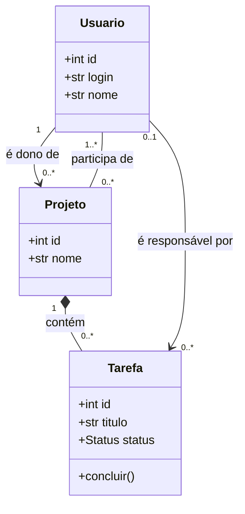
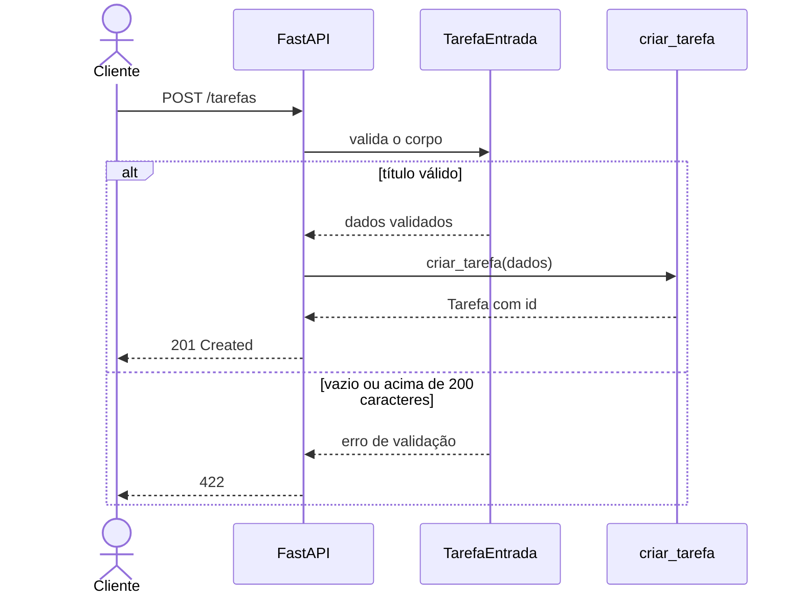
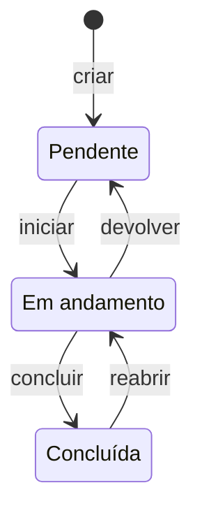
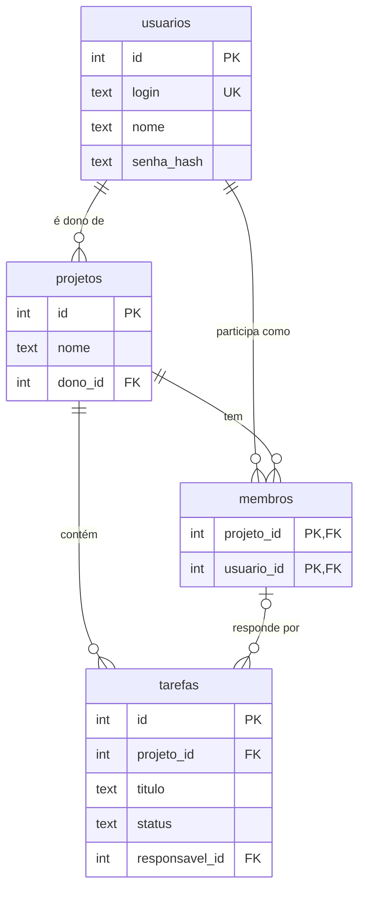
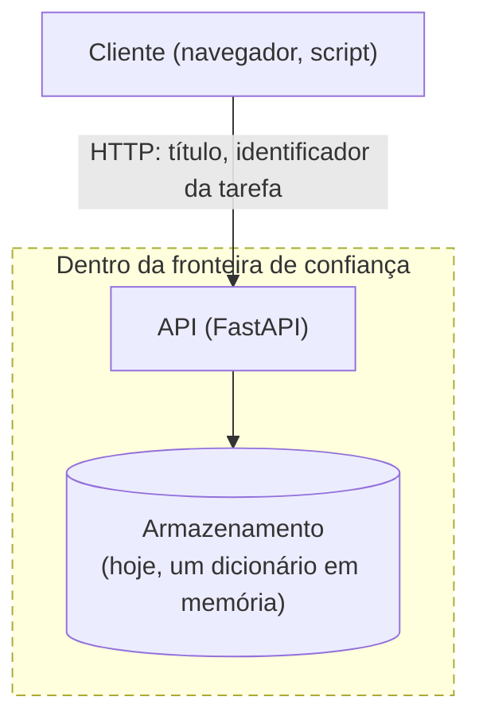

# Projeto e Arquitetura de Software

## 🏗️ Do requisito à estrutura do sistema

Depois de especificados os requisitos, é preciso decidir **como** o sistema será construído: quais componentes existirão, como se comunicam, onde os dados residem, e quais tecnologias sustentam cada peça. Essa é a atividade de **projeto de software**, cujo produto de mais alto nível é a **arquitetura**: a organização fundamental de um sistema, expressa em seus componentes, nas relações entre eles e entre eles e o ambiente, e nos princípios que orientam seu projeto e evolução (definição do padrão IEEE 1471-2000, depois incorporado à ISO/IEC/IEEE 42010).

## 🎯 Princípios de projeto

Alguns princípios atravessam décadas de engenharia de software e continuam orientando decisões de projeto, independente da tecnologia usada:

* **Separação de responsabilidades (*separation of concerns*)**: cada componente deve ter uma responsabilidade bem definida, minimizando sobreposição.
* **Baixo acoplamento, alta coesão**: componentes devem depender pouco uns dos outros (acoplamento) e cada componente deve agrupar responsabilidades fortemente relacionadas entre si (coesão).
* **Abstração**: expor apenas o necessário através de interfaces, escondendo detalhes de implementação.
* **Responsabilidade única**: um módulo deve ter apenas um motivo para mudar. É o primeiro dos cinco princípios **SOLID**, apresentados adiante.
* **[YAGNI](https://www.martinfowler.com/bliki/Yagni.html) (*You Aren't Gonna Need It*)**: não projete flexibilidade para requisitos hipotéticos que ainda não existem — complexidade antecipada tem custo real e nem sempre paga o benefício esperado.

!!! warning "Arquitetura não é só sobre tecnologia"
    Decisões de arquitetura são, no fundo, decisões sobre **onde colocar a complexidade** e **quais mudanças futuras você quer que sejam baratas**. Trocar de banco de dados, adicionar um novo canal de acesso (app mobile), escalar um componente específico — uma boa arquitetura torna algumas dessas mudanças fáceis, ao custo de tornar outras mais difíceis. Não existe arquitetura sem trade-off.

## 🧩 Orientação a objetos em poucas linhas

SOLID, padrões de projeto e diagramas de classes pressupõem alguns conceitos:

* **Classe** e **objeto**: a classe descreve; o objeto é um exemplar, com seu próprio estado;
* **Mensagem**: um objeto pede algo a outro chamando um método;
* **Encapsulamento**: quem usa o objeto depende do que ele oferece, não de como guarda os dados;
* **Herança** ("é um") e **composição** ("tem um"): duas formas de reaproveitar comportamento;
* **Polimorfismo**: objetos diferentes respondem à mesma mensagem, cada um a seu modo.

Para revisar com calma, o livro [Paradigmas de Programação](https://lambdageo-edu.github.io/book-paradigmas-de-programacao/unidade2/01_classes_objetos/) trata de [classes e objetos](https://lambdageo-edu.github.io/book-paradigmas-de-programacao/unidade2/01_classes_objetos/), [relações e herança](https://lambdageo-edu.github.io/book-paradigmas-de-programacao/unidade2/02_relacoes/), [polimorfismo](https://lambdageo-edu.github.io/book-paradigmas-de-programacao/unidade2/03_polimorfismo/) e [interfaces](https://lambdageo-edu.github.io/book-paradigmas-de-programacao/unidade2/04_classes_abstratas_interfaces/). Os exemplos de lá são em Java: os conceitos são os mesmos, a forma muda. Em Python, por exemplo, o encapsulamento é uma convenção (nomes iniciados por `_`), e não é preciso declarar que uma classe implementa um `Protocol`.

## 📏 SOLID na prática

| Princípio | Em uma frase | Sinal de problema |
|---|---|---|
| **S**: responsabilidade única | Um motivo para mudar | A mesma classe calcula, grava e envia e-mail |
| **O**: aberto/fechado | Acrescentar sem reescrever | Cada caso novo exige mais um `elif` |
| **L**: substituição de Liskov | O subtipo cumpre o contrato do tipo | A subclasse recusa um método herdado |
| **I**: segregação de interfaces | Interfaces pequenas | Quem implementa deixa métodos vazios |
| **D**: inversão de dependência | Depender de abstrações | A regra de negócio cria sozinha o banco ou o serviço que usa |

Suponha que se queira exportar as tarefas em mais de um formato (o TaskFlow não faz isso; é um exemplo). A primeira versão costuma ser assim:

```python
def exportar(titulos, formato):
    if formato == "texto":
        return "\n".join(titulos)
    elif formato == "markdown":
        return "\n".join(f"- [ ] {t}" for t in titulos)
    raise ValueError(formato)
```

Cada formato novo modifica essa função. Com o padrão **Strategy**, cada variação vira um objeto, e a função depende apenas do que todos oferecem:

```python
from typing import Protocol


class Formato(Protocol):
    def gerar(self, titulos: list[str]) -> str: ...


class Texto:
    def gerar(self, titulos: list[str]) -> str:
        return "\n".join(titulos)


class Markdown:
    def gerar(self, titulos: list[str]) -> str:
        return "\n".join(f"- [ ] {t}" for t in titulos)


def exportar(titulos: list[str], formato: Formato) -> str:
    return formato.gerar(titulos)
```

Um formato CSV é uma classe nova, sem tocar em `exportar` (**O**). A função depende da abstração `Formato`, e quem chama escolhe a implementação (**D**). A interface tem um só método (**I**), e toda implementação deve devolver um texto com todos os títulos: uma que descartasse alguns quebraria o contrato (**L**).

Com apenas dois formatos que não vão mudar, o `if` é melhor (YAGNI). Em Python, quando a estratégia é uma única operação, uma função costuma bastar no lugar da classe. E às vezes a variação cabe em dados: no TaskFlow, as mudanças de estado são um dicionário (`TRANSICOES`), e não uma sequência de `if`.

## 🧱 Estilos de arquitetura

Os estilos a seguir não são todos alternativas entre si, porque respondem a perguntas diferentes. **Camadas** trata da organização lógica do código. **Monólito** e **microsserviços** tratam de como o sistema é implantado. As duas escolhas se combinam: um monólito pode, e costuma, ser organizado em camadas.

### Arquitetura em camadas

Organiza o sistema em camadas horizontais (ex: apresentação, lógica de negócio, acesso a dados), onde cada camada só se comunica com camadas adjacentes. É um dos estilos mais tradicionais e ainda muito comum em aplicações web e corporativas — simples de entender, mas pode se tornar rígida em sistemas grandes.

### Arquitetura monolítica

Todo o sistema é construído, implantado e escalado como uma única unidade. Um monólito **bem modularizado internamente** (com fronteiras internas claras entre módulos, mesmo dentro de um único deploy) é uma escolha perfeitamente razoável para a maioria dos produtos, especialmente nos estágios iniciais — é mais simples de desenvolver, testar e implantar do que um sistema distribuído.

### Microsserviços

Decompõe o sistema em serviços pequenos, independentes, cada um responsável por uma capacidade de negócio específica, com seu próprio processo e, frequentemente, seu próprio banco de dados. Serviços se comunicam via rede (APIs REST, gRPC, mensageria).

**Vantagens:** times podem desenvolver, implantar e escalar serviços de forma independente; falhas podem ficar contidas a um serviço.

**Custos:** complexidade operacional muito maior (rede, consistência de dados distribuída, observabilidade, versionamento de contratos entre serviços) — um custo que só se paga quando o time e o produto já são grandes o suficiente para justificá-lo.

=== "Monólito"
    * Deploy único, mais simples de operar
    * Transações e consistência de dados mais fáceis (um único banco)
    * Bom ponto de partida para a maioria dos produtos novos
    * Pode ficar difícil de escalar times grandes trabalhando no mesmo código

=== "Microsserviços"
    * Escalabilidade e deploy independentes por serviço
    * Times autônomos, com fronteiras claras de propriedade
    * Exige investimento pesado em observabilidade, CI/CD e infraestrutura
    * Risco real de criar um "monólito distribuído" se as fronteiras entre serviços forem mal desenhadas

!!! tip "Uma regra prática comum na indústria"
    "Comece com um monólito bem modularizado; extraia microsserviços quando (e apenas quando) houver uma razão concreta de escala ou organização de times para justificar o custo operacional extra." Essa recomendação — associada a autores como [Martin Fowler](https://www.martinfowler.com/bliki/MonolithFirst.html) — reconhece que a decomposição em microsserviços é mais fácil de fazer a partir de um monólito bem estruturado do que de projetar corretamente desde o primeiro dia.

### Arquitetura orientada a eventos

Componentes se comunicam produzindo e reagindo a eventos (ex: "pedido criado", "pagamento aprovado"), frequentemente através de um barramento de eventos ou fila de mensagens (Kafka, RabbitMQ, SQS). Favorece o desacoplamento em dois sentidos: **referencial**, porque o produtor não precisa saber quem consome seus eventos, e **temporal**, quando o intermediário guarda as mensagens e o consumidor não precisa estar disponível no momento do envio. Em contrapartida, dificulta rastrear o fluxo completo de um processo de negócio, o que aumenta a importância de boas práticas de observabilidade e *tracing* distribuído.

## 🧩 Padrões de projeto

Enquanto estilos de arquitetura organizam o sistema em larga escala, **padrões de projeto** (*design patterns*) resolvem problemas recorrentes na estrutura interna de componentes. O catálogo clássico, popularizado pelo livro *Design Patterns* (Gamma, Helm, Johnson, Vlissides — o "Gang of Four", 1994), organiza padrões orientados a objetos em três categorias:

| Categoria | Objetivo | Exemplos |
|---|---|---|
| **Criacionais** | Controlar como objetos são criados | Factory Method, Builder, Singleton |
| **Estruturais** | Compor classes e objetos em estruturas maiores | Adapter, Decorator, Facade |
| **Comportamentais** | Organizar responsabilidades e comunicação entre objetos | Strategy, Observer, Command |

Esses padrões seguem relevantes, mas vale um alerta prático: padrões de projeto resolvem problemas de um contexto específico (sistemas orientados a objetos, em linguagens com certas limitações dos anos 1990). Aplicá-los de forma automática, sem que o problema realmente exista, é uma forma comum de complexidade desnecessária — o oposto do princípio YAGNI mencionado acima.

### Adapter: encaixar o que não foi feito para você

O **Adapter** converte a interface que existe na interface que o seu código espera. Imagine que o sistema precise avisar uma pessoa, e a biblioteca escolhida (fictícia, no exemplo) fale em canais:

```python
class BibliotecaDeMensagens:  # de terceiros: não se altera
    def post(self, channel: str, text: str) -> None:
        print(f"{channel}: {text}")


class Notificador:  # o adaptador
    def __init__(self, biblioteca: BibliotecaDeMensagens) -> None:
        self._biblioteca = biblioteca

    def avisar(self, login: str, mensagem: str) -> None:
        self._biblioteca.post(f"@{login}", mensagem)
```

O restante do sistema conhece apenas `avisar`. Trocar de biblioteca significa escrever outro adaptador, e nos testes um objeto falso com o mesmo método ocupa o lugar do serviço real.

!!! warning "Cuidado com o Singleton"
    Ele garante uma única instância, acessível de qualquer lugar. Na prática, costuma funcionar como uma variável global: esconde dependências e faz um teste interferir no outro. Criar o objeto uma vez e passá-lo a quem precisa resolve a maioria dos casos.

## 📐 Modelando a estrutura e as interações

O Capítulo 3 modelou o que o sistema faz. Três diagramas da UML (OMG, 2017) ajudam a decidir como (FOWLER, 2003). Os exemplos de classes e estados descrevem a versão em equipe da API de tarefas, implementada no [TaskFlow](https://github.com/lambdageo-edu/taskflow).

### Classes: o que existe e como se relaciona



Os números são as **multiplicidades**: um projeto tem zero ou mais tarefas, e uma tarefa pode ainda não ter responsável (`0..1`). O losango preenchido indica **composição**: a tarefa não existe fora do seu projeto. Cada uma dessas marcas é uma decisão que precisa ser confirmada com quem pediu o sistema. O diagrama também não diz tudo: no TaskFlow, o responsável precisa ser membro do projeto da tarefa, regra garantida por uma chave estrangeira no banco. O `concluir()` do desenho aparece no código como uma das ações de `POST .../tarefas/{tarefa_id}/{acao}`.

### Sequência: quem chama quem, e em que ordem

Este descreve o `POST /tarefas` com a validação do [Capítulo 6](06_testes_validacao.md):



No caminho de erro, a função `criar_tarefa` nem chega a ser chamada. É o tipo de informação que o diagrama mostra melhor do que o código lido isoladamente.

### Estados: o ciclo de vida de um objeto

Na primeira API, a tarefa tem apenas o campo `concluida`. Na versão em equipe, a decisão foi:



O que **não** está desenhado também é regra: uma tarefa pendente não pode ser concluída direto. Cada transição ausente pode virar um teste; no TaskFlow, essa recebe a resposta 409.

!!! tip "Quando vale a pena"
    Classes ajudam a discutir o domínio antes de criar o banco de dados. Sequência, quando vários componentes colaboram ou o tratamento de erro não é óbvio. Estados, quando um objeto muda de situação e nem toda mudança é permitida. Diagrama desatualizado engana: mantenha poucos, junto do código.

!!! warning "Diagramas gerados por IA"
    Um assistente produz diagramas com boa aparência a partir de uma descrição curta. Confira cada multiplicidade e cada transição: o que a descrição não disse foi inventado.

## 🗄️ Modelando os dados

Código se reescreve; dados gravados ficam. Por isso o modelo de dados merece decisão própria. No modelo **relacional**, proposto por Codd (1970), os dados ficam em tabelas ligadas por valores. Partindo do diagrama de classes, o TaskFlow chegou a estas tabelas (a de sessões ficou de fora do desenho):



Algumas regras de passagem:

* cada classe vira, em geral, uma **tabela**, e cada atributo, uma coluna;
* a **chave primária** identifica cada linha (`id`);
* uma relação "um para muitos" vira uma **chave estrangeira** no lado "muitos" (`tarefas.projeto_id`);
* uma relação "muitos para muitos", como a participação em projetos, vira uma **tabela associativa** (`membros`);
* o que é opcional vira coluna que aceita nulo (`responsavel_id`).

Guarde cada fato em um só lugar. Se o nome do dono fosse copiado em cada projeto, uma correção teria de alterar várias linhas, e esquecer uma criaria duas versões. Organizar as tabelas para evitar esse tipo de redundância chama-se **normalização**.

O banco também pode garantir regras, mesmo que o código tenha um defeito (trecho de `app/db.py`):

```sql
CREATE TABLE IF NOT EXISTS tarefas (
    id             INTEGER PRIMARY KEY,
    projeto_id     INTEGER NOT NULL REFERENCES projetos(id) ON DELETE CASCADE,
    titulo         TEXT NOT NULL CHECK (length(titulo) BETWEEN 1 AND 200),
    status         TEXT NOT NULL DEFAULT 'pendente'
                   CHECK (status IN ('pendente', 'em_andamento', 'concluida')),
    responsavel_id INTEGER,
    FOREIGN KEY (projeto_id, responsavel_id) REFERENCES membros(projeto_id, usuario_id)
);
```

A última restrição impede atribuir uma tarefa a quem não é membro do projeto. No SQLite, as chaves estrangeiras só são verificadas se a conexão executar [`PRAGMA foreign_keys = ON`](https://www.sqlite.org/foreignkeys.html), o que o TaskFlow faz ao conectar.

Quando uma operação grava em mais de um lugar, use uma **transação**: ou tudo é gravado, ou nada. Ao criar um projeto, o TaskFlow insere o projeto e o primeiro membro juntos. Mudar o esquema depois que há dados exige migração ([Capítulo 8](08_evolucao_manutencao.md)).

O modelo relacional é uma boa escolha inicial quando os dados têm relações e regras. Bancos de documentos, de chave e valor ou de grafos atendem a outras formas de acesso: decida pelas consultas e garantias de que o sistema precisa, e registre o porquê em um [registro de decisão de arquitetura](#documentando-e-comunicando-arquitetura) (ADR).

## 🛡️ Segurança desde o projeto

Uma falha de código se corrige com um *commit*. Uma falha de projeto, como não prever quem pode acessar o quê, costuma exigir mudar modelo de dados, interfaces e código já escrito. Por isso a segurança entra nas decisões de arquitetura. Alguns princípios antigos continuam válidos, vários deles formulados por Saltzer e Schroeder em 1975:

* **Privilégio mínimo**: cada pessoa e cada componente recebe apenas as permissões de que precisa (o `USER appuser` do [Capítulo 7](07_integracao_entrega_continua.md) é um exemplo).
* **Negar por padrão**: o acesso precisa ser concedido explicitamente; na dúvida ou em caso de erro, recusa-se.
* **Mediação completa**: a permissão é verificada em todo acesso, no servidor, e não apenas escondendo um botão na tela.
* **Simplicidade**: quanto menor e mais simples o mecanismo, mais fácil revisá-lo.
* **Defesa em profundidade**: mais de uma barreira, para que a falha de uma não exponha tudo.
* **Reduzir a superfície de ataque**: o que não está exposto não pode ser atacado.

### Modelagem de ameaças

**Modelar ameaças** é analisar o projeto para descobrir o que pode dar errado antes que alguém descubra por você. Um roteiro enxuto usa [quatro perguntas](https://threatmodelingmanifesto.org/):

1. No que estamos trabalhando?
2. O que pode dar errado?
3. O que vamos fazer a respeito?
4. Fizemos um trabalho bom o suficiente?

Para a primeira, basta um diagrama de por onde os dados passam, marcando as **fronteiras de confiança**: os pontos em que um dado vem de alguém em quem o sistema não deve confiar. Na API de tarefas, a fronteira é a linha tracejada:



Para a segunda, o acrônimo **STRIDE**, proposto na Microsoft por Kohnfelder e Garg em 1999, serve de lista de conferência. Aplicado à primeira versão da API:

| Ameaça | Propriedade violada | Na API de tarefas |
|---|---|---|
| ***S**poofing* (falsificação de identidade) | Autenticação | Não há identificação: o sistema não sabe quem está pedindo. |
| ***T**ampering* (adulteração) | Integridade | Qualquer um conclui qualquer tarefa. |
| ***R**epudiation* (repúdio) | Responsabilização | Não há registro de quem concluiu uma tarefa. |
| ***I**nformation disclosure* (vazamento) | Confidencialidade | `GET /tarefas` entrega todas as tarefas a quem pedir. |
| ***D**enial of service* (negação de serviço) | Disponibilidade | Não há limite de tamanho do título nem de requisições. |
| ***E**levation of privilege* (elevação de privilégio) | Autorização | Ainda não há papéis. Quando houver, um membro não pode agir como dono do projeto. |

Para a terceira, cada ameaça recebe uma resposta: **mitigar** (reduzir a chance ou o dano), **eliminar** (retirar a funcionalidade que a cria), **transferir** (passar a responsabilidade a outro, como um provedor de identidade, registrando o risco que sobra) ou **aceitar** (conscientemente, com o motivo). Por exemplo, enquanto a API só roda na máquina do desenvolvedor, a falta de autenticação pode ser aceita. Antes de publicá-la na rede, precisa ser mitigada. O limite do título é barato e pode ser feito já.

!!! warning "Quando houver usuários, confira o dono de cada objeto"
    Autenticar não basta. Se `PATCH /tarefas/42/concluir` verifica apenas se há alguém conectado, qualquer usuário conclui a tarefa de outro trocando o número. Essa falha, a *autorização quebrada em nível de objeto*, é a [primeira da lista OWASP de riscos em APIs](https://owasp.org/API-Security/editions/2023/en/0xa1-broken-object-level-authorization/) (edição de 2023).

### O que o TaskFlow respondeu

Ao ganhar rede, usuários e banco de dados, o [TaskFlow](https://github.com/lambdageo-edu/taskflow) precisou revisitar a tabela:

| Ameaça | Resposta no código | O que continua aberto |
|---|---|---|
| Falsificação de identidade | *Login* com senha e token de sessão que expira | HTTPS e limite de tentativas de *login* |
| Adulteração | Permissão conferida a cada requisição; consultas SQL com parâmetros | Proteção do arquivo do banco no servidor |
| Repúdio | Nenhuma | Registro de quem fez cada mudança |
| Vazamento | Quem não é membro recebe 404; o banco guarda só o *hash* da senha e do token | HTTPS e proteção de cópias de segurança |
| Negação de serviço | Limite de tamanho do título, dos nomes e da senha | Limite de requisições e do tamanho do corpo |
| Elevação de privilégio | Só o dono adiciona membros e atribui tarefas a outras pessoas | Revisar a cada endpoint novo |

A coluna da direita é tão importante quanto a do meio: um risco escrito pode ser tratado ou aceito; um risco esquecido, não.

A quarta pergunta lembra que o modelo não é um documento de uma vez só: revise-o quando surgir um novo endpoint, integração ou tipo de dado, e guarde-o no repositório, junto com os ADRs.

## 🤖 IA nas decisões de projeto

Assistentes de IA são úteis como interlocutores: propõem alternativas, apontam *trade-offs*, rascunham um ADR e sugerem ameaças que o time não listou. Os limites também são claros:

* eles não conhecem o orçamento, o time, os prazos nem a história do sistema, a menos que alguém conte, e mesmo assim parcialmente;
* uma lista de ameaças gerada pode parecer completa e ignorar a mais importante do seu domínio;
* nomes de bibliotecas, recursos e referências precisam ser conferidos, porque podem não existir;
* diagramas e configurações podem revelar detalhes sensíveis da infraestrutura: verifique o que pode ser enviado à ferramenta.

A decisão continua sendo do time. Um bom teste: quem aprovou consegue explicar, sem a ferramenta, por que essa alternativa foi escolhida e o que se perde com ela?

## 🗺️ Documentando e comunicando arquitetura

Arquitetura só é útil se for compreendida por quem constrói o sistema. Algumas ferramentas práticas:

* **Diagramas C4** (Contexto, Contêineres, Componentes, Código): um modelo proposto por Simon Brown, de diagramação em quatro níveis de zoom, do mais abstrato (como o sistema se encaixa no mundo) ao mais detalhado (classes de um componente específico) — uma alternativa mais leve do que modelar o sistema inteiro em UML.
* **Registros de Decisão de Arquitetura (*Architecture Decision Records* — ADRs)**, [popularizados por Michael Nygard](https://cognitect.com/blog/2011/11/15/documenting-architecture-decisions): pequenos documentos versionados junto ao código, cada um registrando uma decisão de arquitetura. O modelo de Nygard tem cinco partes: título, contexto, decisão, situação (*status*) e consequências. Muitas equipes acrescentam as alternativas consideradas. São úteis para que decisões antigas não pareçam arbitrárias para quem chega depois no time.
* **UML**, ainda útil para diagramas específicos (classes, sequência) quando o nível de detalhe compensa o custo de mantê-los atualizados — mas raramente usado hoje como especificação completa e exaustiva de um sistema, como se popularizou nos anos 1990/2000.

---

## 🎯 Atividades

1. Para um sistema de e-commerce de pequeno porte, você optaria por um monólito modularizado ou por microsserviços? Justifique com base nos trade-offs discutidos.
2. Escreva um ADR curto (título, contexto, decisão, situação, consequências e alternativas consideradas) para a escolha de arquitetura do item anterior.
3. Identifique um padrão de projeto (dos criacionais, estruturais ou comportamentais) que você já usou, mesmo sem saber o nome, em algum código que escreveu. Descreva o problema que ele resolveu.
4. Faça a modelagem de ameaças de uma funcionalidade pequena (por exemplo, atribuir uma tarefa a outra pessoa): diagrama com a fronteira de confiança, ao menos quatro ameaças do STRIDE e a resposta escolhida para cada uma.
5. Peça a um assistente de IA ameaças para a mesma funcionalidade. Separe as que acrescentam algo, as genéricas e as erradas.
6. Inclua no diagrama de estados uma tarefa cancelada. De quais estados se chega a ela? É possível reativá-la? Escreva os testes que essas respostas sugerem.
7. Acrescente o formato CSV ao exemplo de exportação, primeiro na versão com `if` e depois na versão com Strategy. Em cada uma, o que precisou mudar? Escreva um teste que valha para todos os formatos.
8. Acrescente etiquetas às tarefas: uma tarefa pode ter várias, e uma etiqueta serve a várias tarefas. Que tabelas surgem, com quais chaves e restrições?

## 📚 Para saber mais

* SOMMERVILLE, Ian. *Engenharia de Software*. 10. ed. — Capítulo 6.
* SOMMERVILLE, Ian. *Engenharia de Software*. 10. ed. — Capítulo 5 (modelagem de sistemas).
* OMG. *Unified Modeling Language*, versão 2.5.1, 2017 — [omg.org/spec/UML](https://www.omg.org/spec/UML/About-UML/)
* FOWLER, Martin. *UML Distilled*. 3. ed. Addison-Wesley, 2003.
* CODD, E. F. *A Relational Model of Data for Large Shared Data Banks*. Communications of the ACM, 13(6), 1970.
* SQLite, *Foreign Key Support* — [sqlite.org](https://www.sqlite.org/foreignkeys.html)
* GAMMA, Erich et al. *Design Patterns: Elements of Reusable Object-Oriented Software*. Addison-Wesley, 1994.
* FOWLER, Martin. *Patterns of Enterprise Application Architecture*. Addison-Wesley, 2002.
* OWASP *Threat Modeling Cheat Sheet* — [cheatsheetseries.owasp.org](https://cheatsheetseries.owasp.org/cheatsheets/Threat_Modeling_Cheat_Sheet.html)
* KOHNFELDER, Loren; GARG, Praerit. *The Threats to Our Products*. Microsoft, 1999 (origem do STRIDE) — [cópia do documento](https://threatmodelingbook.com/files/microsoft/The-Threats-To-Our-Products.docx)
* *Threat Modeling Manifesto* — [threatmodelingmanifesto.org](https://threatmodelingmanifesto.org/)
* *OWASP API Security Top 10*, edição de 2023 — [owasp.org/API-Security](https://owasp.org/API-Security/editions/2023/en/0xa1-broken-object-level-authorization/)
* SALTZER, Jerome H.; SCHROEDER, Michael D. *The Protection of Information in Computer Systems*. Proceedings of the IEEE, 63(9), 1975.
* Modelo C4 — [c4model.com](https://c4model.com/)
* NEWMAN, Sam. *Building Microservices*. 2. ed. O'Reilly, 2021.
* IEEE Std 1471-2000. *Recommended Practice for Architectural Description of Software-Intensive Systems* (substituído pela ISO/IEC/IEEE 42010).
* MARTIN, Robert C. *Agile Software Development: Principles, Patterns, and Practices*. Prentice Hall, 2002 (princípios SOLID).
* FOWLER, Martin. *Yagni* — [martinfowler.com](https://www.martinfowler.com/bliki/Yagni.html); *Monolith First*, 2015 — [martinfowler.com](https://www.martinfowler.com/bliki/MonolithFirst.html)
* NYGARD, Michael. *Documenting Architecture Decisions*, 2011 — [cognitect.com](https://cognitect.com/blog/2011/11/15/documenting-architecture-decisions)
