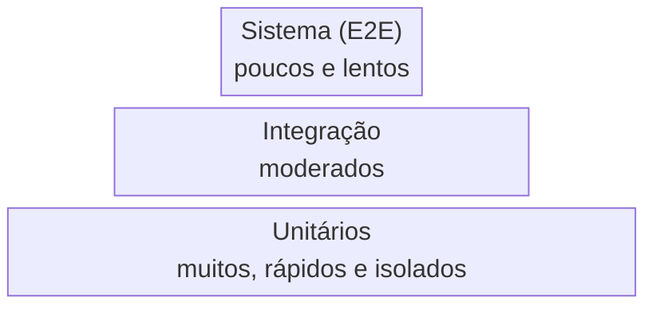

# Testes e Validação

## ⚖️ Verificação e validação

Testar é parte de algo maior. Barry Boehm resumiu a diferença em duas perguntas:

| | Pergunta | Compara o software com | Exemplos |
|---|---|---|---|
| **Verificação** | Estamos construindo o produto **da maneira certa**? | A especificação | Revisão, análise estática, testes automatizados |
| **Validação** | Estamos construindo o **produto certo**? | A necessidade de quem vai usar | Protótipos, demonstrações, testes de aceitação e beta |

As duas podem discordar. Se o requisito diz que qualquer membro conclui qualquer tarefa, um sistema que faz exatamente isso passa na verificação. Se a equipe queria que só o responsável pudesse concluir, ele falha na validação: o erro está no requisito. Por isso a validação começa antes do código ([Capítulo 3](03_especificacao_requisitos.md)).

## 🧭 Defeito, erro e falha

Antes de falar em testes, vale distinguir três termos que costumam ser usados de forma intercambiável, mas que têm significados técnicos distintos (a distinção é detalhada por Avizienis e coautores, 2004):

* **Defeito (*fault*/*bug*)**: uma característica estática e incorreta do código-fonte — uma linha escrita errada, uma condição invertida.
* **Erro (*error*)**: um estado interno incorreto do sistema em tempo de execução, causado por um defeito ao ser exercitado.
* **Falha (*failure*)**: o comportamento observável e incorreto do sistema, visível para o usuário ou para outro sistema — a consequência externa de um erro.

Um defeito pode existir no código por anos sem nunca causar uma falha, se o caminho de código que o contém nunca for exercitado com as condições certas. Testes automatizados existem justamente para aumentar a chance de descobrir defeitos **antes** que eles se tornem falhas em produção.

## 🔬 Inspeções e revisões

Nem todo defeito é encontrado executando o código. **Inspeções** e **revisões** (Capítulo 5) são técnicas de verificação estática — analisar o código sem executá-lo — e são complementares aos testes: uma inspeção pode encontrar um problema de lógica que um teste mal escrito não cobriria, e vice-versa. Times maduros combinam as duas abordagens: revisão de código para design e lógica, análise estática (Capítulo 5) para padrões mecânicos, e testes automatizados para comportamento em tempo de execução.

## 🔺 A pirâmide de testes

A **pirâmide de testes**, popularizada por Mike Cohn, organiza os testes automatizados em camadas conforme seu escopo, velocidade e custo de manutenção. No original de Cohn, as camadas se chamam [*unit*, *service* e *user interface*](https://martinfowler.com/articles/practical-test-pyramid.html); o desenho usa os nomes por escopo:



* **Testes unitários** verificam uma unidade de código isolada (uma função, um método), sem dependências externas reais (banco de dados, rede). São rápidos, numerosos e baratos de manter — a base da pirâmide.
* **Testes de integração** verificam a colaboração entre algumas unidades reais, ou entre a aplicação e uma dependência externa real (um banco de dados de teste, por exemplo).
* **Testes de sistema (ponta a ponta, ou E2E)** verificam o sistema completo, muitas vezes através de suas interfaces externas (API, UI), simulando um uso real de ponta a ponta. São os mais caros de escrever e manter, e os mais lentos de executar — por isso devem ser relativamente poucos, cobrindo os fluxos mais críticos.

!!! warning "O antipadrão do 'cone de sorvete'"
    Um erro comum é ter muitos testes de ponta a ponta (lentos, frágeis, caros de manter) e poucos testes unitários — o oposto da pirâmide. Isso é chamado de "cone de sorvete", porque o formato é o da pirâmide virada de ponta-cabeça: a suíte de testes fica lenta, instável e cara de manter, exatamente o oposto do que se espera de uma boa suíte de testes.

!!! note "Nível e objetivo são coisas diferentes"
    Unitário, integração e sistema são **níveis**: dizem quanto do software o teste exercita. **Aceitação** é um **objetivo**: confirmar que o software atende ao que foi combinado. Um teste de aceitação pode ser escrito em mais de um nível.

## 🧪 Tipos de teste no ciclo de desenvolvimento

Além da divisão por escopo, testes também se distinguem por **quem** os executa e **quando**, ao longo do ciclo de vida:

* **Testes em desenvolvimento**: escritos e executados pelos próprios desenvolvedores, continuamente, enquanto o código é escrito — testes unitários, de integração e de sistema.
* **Testes de release**: executados por um time (ou processo automatizado) separado, validando uma versão candidata a ser lançada antes de ir para produção.
* **Testes de usuário**: envolvem usuários reais ou representantes do cliente, tipicamente perto do fim do ciclo:
    * **Teste alfa**: usuários selecionados testam o sistema no ambiente de desenvolvimento, com a equipe observando.
    * **Teste beta**: uma versão é liberada a um grupo maior de usuários reais, em seu próprio ambiente, coletando feedback antes do lançamento geral.
    * **Teste de aceitação**: o cliente (ou seu representante) valida formalmente que o sistema atende aos requisitos acordados — muitas vezes usando os próprios critérios de aceitação escritos junto com os requisitos (Capítulo 3).

### De critério de aceitação a teste

O formato *Dado/Quando/Então* (Gherkin), visto no Capítulo 3, descreve um cenário que pode ser automatizado. Para a API de tarefas usada neste capítulo:

```gherkin
# language: pt
Funcionalidade: Conclusão de tarefas

  Cenário: Concluir uma tarefa existente
    Dado que existe a tarefa "Testar conclusão"
    Quando eu concluo essa tarefa
    Então ela aparece como concluída
```

Ferramentas como Behave ou pytest-bdd ligam cada linha do cenário a uma função. Sem elas, o mesmo roteiro pode organizar um teste comum, como faz `test_concluir_tarefa_muda_status` mais adiante.

## 🔴🟢🔵 Test-Driven Development (TDD)

TDD é uma prática (não apenas uma técnica de teste) em que o teste é escrito **antes** do código de produção, seguindo um ciclo curto e repetitivo:

1. **🔴 Red**: escreva um teste para uma funcionalidade que ainda não existe. Ele deve falhar (o código ainda não existe para satisfazê-lo).
2. **🟢 Green**: escreva o código mínimo necessário para o teste passar — sem se preocupar ainda com elegância.
3. **🔵 Refactor**: com o teste passando como rede de segurança, melhore o código (Capítulo 5) sem mudar seu comportamento externo.

A promessa do TDD não é "ter mais testes" — é que escrever o teste primeiro força a pensar na interface e no comportamento esperado antes dos detalhes de implementação, e garante que todo código de produção tenha, desde o nascimento, um teste que o cubra.

---

## 🧑‍💻 Hands-on: testando uma API com pytest e FastAPI

Vamos aplicar os conceitos acima construindo e testando uma pequena **API de tarefas** com [FastAPI](https://fastapi.tiangolo.com/) e [pytest](https://docs.pytest.org/), a dupla mais usada hoje no ecossistema Python para esse tipo de projeto.

### Preparando o ambiente

```bash
mkdir api-tarefas && cd api-tarefas
python -m venv .venv
source .venv/bin/activate   # no Windows: .venv\Scripts\activate

pip install fastapi "uvicorn[standard]" pytest httpx2 pytest-cov
```

!!! note "Por que `httpx2`?"
    O `TestClient` do FastAPI (usado nos testes abaixo) é construído sobre o `httpx2` — a continuação, sob nova manutenção, do projeto `httpx`, que hoje está com atividade limitada. É essa biblioteca que permite simular requisições à API sem precisar de um servidor rodando de verdade durante os testes. Instalar apenas o `httpx` (sem o `httpx2`) ainda funciona, mas gera um aviso de depreciação a cada execução da suíte de testes.

### A aplicação: `app/main.py`

```python
from fastapi import FastAPI, HTTPException
from pydantic import BaseModel

app = FastAPI(title="API de Tarefas")


class TarefaEntrada(BaseModel):
    titulo: str
    concluida: bool = False


class Tarefa(TarefaEntrada):
    id: int


_tarefas: dict[int, Tarefa] = {}
_proximo_id = 1


@app.post("/tarefas", response_model=Tarefa, status_code=201)
def criar_tarefa(dados: TarefaEntrada) -> Tarefa:
    global _proximo_id
    if not dados.titulo.strip():
        raise HTTPException(status_code=422, detail="Título não pode ser vazio")
    tarefa = Tarefa(id=_proximo_id, **dados.model_dump())
    _tarefas[tarefa.id] = tarefa
    _proximo_id += 1
    return tarefa


@app.get("/tarefas", response_model=list[Tarefa])
def listar_tarefas() -> list[Tarefa]:
    return list(_tarefas.values())


@app.get("/tarefas/{tarefa_id}", response_model=Tarefa)
def obter_tarefa(tarefa_id: int) -> Tarefa:
    tarefa = _tarefas.get(tarefa_id)
    if tarefa is None:
        raise HTTPException(status_code=404, detail="Tarefa não encontrada")
    return tarefa


@app.patch("/tarefas/{tarefa_id}/concluir", response_model=Tarefa)
def concluir_tarefa(tarefa_id: int) -> Tarefa:
    tarefa = _tarefas.get(tarefa_id)
    if tarefa is None:
        raise HTTPException(status_code=404, detail="Tarefa não encontrada")
    tarefa.concluida = True
    return tarefa
```

Não deixe de criar um `app/__init__.py` vazio para que `app` seja reconhecido como um pacote Python.

### Executando a API

Com o ambiente virtual ativo, na pasta `api-tarefas`:

```bash
uvicorn app.main:app --reload
```

`app.main:app` significa o objeto `app` do módulo `app/main.py`. A opção `--reload` reinicia o servidor quando o código muda, e serve só para desenvolvimento. Em outro terminal, crie e liste tarefas:

```bash
curl -i -X POST http://localhost:8000/tarefas \
  -H "Content-Type: application/json" -d '{"titulo": "Estudar HTTP"}'
curl http://localhost:8000/tarefas
```

O `-i` mostra o código e os cabeçalhos da resposta. Em `http://localhost:8000/docs` há uma página para experimentar a API pelo navegador. `Ctrl+C` encerra o servidor, e as tarefas, que estavam na memória, se perdem. Se os termos forem novos, veja o [apêndice sobre HTTP](../apendices/http_api.md).

### Os testes: `test_main.py`

```python
import pytest
from fastapi.testclient import TestClient

from app import main

client = TestClient(main.app)


@pytest.fixture(autouse=True)
def estado_limpo():
    main._tarefas.clear()
    main._proximo_id = 1


def test_criar_tarefa_retorna_201_e_id():
    resposta = client.post("/tarefas", json={"titulo": "Estudar pytest"})
    assert resposta.status_code == 201
    corpo = resposta.json()
    assert corpo["titulo"] == "Estudar pytest"
    assert corpo["concluida"] is False
    assert "id" in corpo


def test_criar_tarefa_com_titulo_vazio_retorna_422():
    resposta = client.post("/tarefas", json={"titulo": "   "})
    assert resposta.status_code == 422


def test_listar_tarefas_inclui_tarefa_criada():
    client.post("/tarefas", json={"titulo": "Ler capítulo 6"})
    resposta = client.get("/tarefas")
    assert resposta.status_code == 200
    titulos = [t["titulo"] for t in resposta.json()]
    assert "Ler capítulo 6" in titulos


def test_obter_tarefa_inexistente_retorna_404():
    resposta = client.get("/tarefas/9999")
    assert resposta.status_code == 404


def test_concluir_tarefa_muda_status():
    # Dado que existe a tarefa
    criada = client.post("/tarefas", json={"titulo": "Testar conclusão"}).json()
    # Quando eu concluo essa tarefa
    resposta = client.patch(f"/tarefas/{criada['id']}/concluir")
    # Então ela aparece como concluída
    assert resposta.status_code == 200
    assert resposta.json()["concluida"] is True
```

Repare que cada teste segue implicitamente o padrão **Arrange-Act-Assert**: prepara os dados de entrada, executa a ação sob teste, e verifica o resultado — uma estrutura que vale a pena manter explícita mesmo quando o código não a nomeia.

Esses testes fazem requisições à API inteira, por meio do `TestClient`. São, portanto, **testes de API**, que atravessam rota, validação e regra juntas, e não testes unitários. Como a aplicação guarda as tarefas em memória, a *fixture* `estado_limpo` zera esse estado antes de cada teste, para que o resultado de um não dependa dos anteriores.

### Executando e medindo cobertura

```bash
pytest -v --cov=app --cov-report=term-missing
```

Saída esperada com Python 3.14 (em outras versões a contagem de instruções pode mudar; o tempo e a largura das colunas também variam):

```
test_main.py::test_criar_tarefa_retorna_201_e_id PASSED
test_main.py::test_criar_tarefa_com_titulo_vazio_retorna_422 PASSED
test_main.py::test_listar_tarefas_inclui_tarefa_criada PASSED
test_main.py::test_obter_tarefa_inexistente_retorna_404 PASSED
test_main.py::test_concluir_tarefa_muda_status PASSED

Name              Stmts   Miss  Cover   Missing
-----------------------------------------------
app/__init__.py       0      0   100%
app/main.py          32      2    94%   41, 48
-----------------------------------------------
TOTAL                32      2    94%

5 passed in 1.12s
```

94% de cobertura é um bom resultado, mas repare que o relatório aponta exatamente **quais** linhas não foram exercitadas (`Missing: 41, 48`). A linha 41 é o retorno de sucesso de `obter_tarefa`: nenhum teste busca por `id` uma tarefa que existe. A linha 48 é o erro 404 de `concluir_tarefa`: nenhum teste tenta concluir uma tarefa inexistente. A cobertura conta qualquer execução da linha, direta ou indireta, portanto uma linha listada como `Missing` não foi executada por teste algum. Esse é o valor de medir cobertura: não é uma meta a perseguir por si só, mas um mapa de quais partes do comportamento ainda não têm uma rede de segurança.

!!! danger "Cobertura alta não é sinônimo de bons testes"
    100% de cobertura significa apenas que toda linha foi **executada** por algum teste — não que o comportamento foi **verificado** corretamente. É possível ter cobertura total com testes que não fazem nenhuma asserção significativa. Use cobertura para encontrar código não testado, nunca como meta isolada de qualidade.

### Praticando TDD nesta API

Com a API montada, como exercício de TDD, tente adicionar um endpoint `DELETE /tarefas/{tarefa_id}` seguindo o ciclo Red-Green-Refactor:

1. **Red**: escreva `test_deletar_tarefa_remove_da_lista`, chamando um endpoint que ainda não existe.
2. **Green**: implemente o `DELETE /tarefas/{tarefa_id}` da forma mais simples possível para o teste passar.
3. **Refactor**: revise o código à luz das práticas de clean code do Capítulo 5.

## 🤖 Testes gerados por IA

Assistentes de codificação são cada vez mais usados para gerar testes automaticamente a partir do código de produção — uma forma rápida de aumentar cobertura numérica. O alerta acima vale com ainda mais força nesse caso: um teste gerado a partir do código existente tende a **confirmar o que o código já faz**, inclusive quando o código tem um defeito, em vez de verificar o que o código **deveria** fazer segundo o requisito. É o oposto do espírito do TDD (visto acima), em que o teste nasce do requisito, antes do código existir.

Isso não invalida o uso de IA para gerar testes — apenas desloca a responsabilidade do desenvolvedor: ler e validar cada teste gerado contra o comportamento esperado (não contra o comportamento atual do código) continua sendo indispensável antes de aceitar a mudança na suíte.

## 🔐 Da história de abuso ao teste

O [Capítulo 3](03_especificacao_requisitos.md) registrou uma história de abuso: títulos enormes esgotando a memória do servidor. Vamos tratá-la com o ciclo do TDD. Primeiro, o teste, acrescentado a `test_main.py`:

```python
@pytest.mark.parametrize("tamanho, status", [(200, 201), (201, 422)])
def test_limite_do_titulo(tamanho, status):
    resposta = client.post("/tarefas", json={"titulo": "a" * tamanho})
    assert resposta.status_code == status
    assert len(client.get("/tarefas").json()) == (1 if status == 201 else 0)
```

Ao rodar `pytest`, o caso de 201 caracteres falha: a API ainda o aceita. Agora a correção em `app/main.py`, que substitui a classe `TarefaEntrada` pela versão com limite ([Capítulo 5](05_implementacao_qualidade.md)):

```python
from typing import Annotated

from fastapi import FastAPI, HTTPException
from pydantic import BaseModel, StringConstraints

app = FastAPI(title="API de Tarefas")

Titulo = Annotated[
    str,
    StringConstraints(strip_whitespace=True, min_length=1, max_length=200),
]


class TarefaEntrada(BaseModel):
    titulo: Titulo
    concluida: bool = False
```

Em `criar_tarefa`, as duas linhas do `if not dados.titulo.strip()` podem ser removidas, porque o modelo já recusa título vazio ou só com espaços. Os testes confirmam: os anteriores continuam passando e os dois novos também.

O limite impede que um título enorme seja **armazenado**, mas o servidor ainda lê a requisição inteira antes de validá-la. Limitar o tamanho do corpo e a quantidade de requisições é tarefa do servidor ou do *proxy* à frente dele, e essa parte do risco continua aberta.

## 🎲 Como escolher os casos de teste

Não é possível testar todas as entradas. Projetar casos de teste é escolher poucos que tenham boa chance de revelar defeitos. Há dois pontos de partida, que se completam:

* **Caixa-preta**: os casos vêm do requisito, sem olhar o código;
* **Caixa-branca**: os casos vêm da estrutura do código, para exercitar linhas e desvios ainda não percorridos. A cobertura, vista acima, ajuda aqui (a opção `--cov-branch` mede também os desvios).

### Partição de equivalência e valores-limite

A **partição de equivalência** divide as entradas em classes que o sistema deve tratar do mesmo jeito: basta um representante de cada uma. A **análise de valores-limite** acrescenta as bordas entre as classes, onde se concentram erros como trocar `<` por `<=` (MYERS; SANDLER; BADGETT, 2011). Para o título, contado sem os espaços das pontas:

| Classe | Esperado | Valores escolhidos |
|---|---|---|
| Vazio | 422 | `""` e só espaços |
| De 1 a 200 caracteres | 201 | 1 e 200 |
| Mais de 200 | 422 | 201 |

```python
@pytest.mark.parametrize(
    "titulo, status",
    [("", 422), ("   ", 422), ("a", 201), ("a" * 200, 201), ("a" * 201, 422)],
)
def test_classes_e_limites_do_titulo(titulo, status):
    resposta = client.post("/tarefas", json={"titulo": titulo})
    assert resposta.status_code == status
```

Quando o comportamento depende do estado, as combinações vêm do diagrama de estados ([Capítulo 4](04_projeto_arquitetura.md)). No TaskFlow há três estados e quatro ações: doze combinações, das quais só quatro são permitidas. Testar as recusadas é tão importante quanto testar as aceitas.

### Dublês de teste

Às vezes uma dependência é lenta, cara ou tem efeitos que não se quer no teste, como enviar uma mensagem. Um **dublê de teste** ocupa o lugar dela. O termo, de Gerard Meszaros, cobre variações: um *stub* devolve respostas prontas; um *fake* funciona de forma simplificada, como um banco em memória; um *spy* registra como foi chamado; um *mock* é programado com as chamadas que espera receber. No exemplo abaixo, que não faz parte do TaskFlow, um *spy* substitui o `Notificador` do [Capítulo 4](04_projeto_arquitetura.md):

```python
class NotificadorEspiao:
    def __init__(self):
        self.avisos = []

    def avisar(self, login, mensagem):
        self.avisos.append((login, mensagem))


def atribuir(tarefa, login, notificador):
    tarefa["responsavel"] = login
    notificador.avisar(login, f"Você agora responde por: {tarefa['titulo']}")


def test_atribuir_avisa_o_responsavel():
    espiao = NotificadorEspiao()
    atribuir({"titulo": "Publicar"}, "bia", espiao)
    assert espiao.avisos == [("bia", "Você agora responde por: Publicar")]
```

Isso é possível porque `atribuir` recebe o notificador em vez de criá-lo (inversão de dependência). Use dublês com parcimônia: um teste cheio deles pode passar enquanto as peças reais não se entendem, e por isso os testes de integração continuam necessários.

### Regressão e desempenho

Uma **regressão** é algo que funcionava e deixou de funcionar depois de uma mudança. **Testar a regressão** é repetir os testes a cada mudança, o que a suíte automatizada faz no pipeline ([Capítulo 7](07_integracao_entrega_continua.md)). Ao corrigir um defeito, escreva primeiro um teste que o reproduza: ele ajuda a impedir que volte.

Os testes deste capítulo verificam o que a API responde, não a rapidez. Um requisito como "95% das respostas em menos de 300 ms sob certa carga" ([Capítulo 3](03_especificacao_requisitos.md)) pede **teste de carga**, com ferramentas como [Locust](https://locust.io/) ou [k6](https://grafana.com/docs/k6/latest/), em um ambiente parecido com o de produção.

## 🧱 Testes com banco e permissões: o TaskFlow

Quando a API ganha persistência e usuários, os testes mudam em dois pontos. O código abaixo é do [TaskFlow](https://github.com/lambdageo-edu/taskflow).

**Cada teste precisa do seu próprio banco.** Se todos escrevem no mesmo arquivo, o resultado de um depende da ordem dos outros. A *fixture* de `tests/conftest.py` usa a pasta temporária do pytest (`tmp_path`) e já deixa o cliente autenticado:

```python
@pytest.fixture
def client(tmp_path, monkeypatch):
    # Cada teste usa um banco novo, em uma pasta temporária.
    monkeypatch.setenv("TAREFAS_DB", str(tmp_path / "teste.db"))
    with TestClient(app) as cliente:
        autenticar(cliente)
        yield cliente
```

O `with` executa o código de inicialização da aplicação, que cria as tabelas.

**O que é proibido precisa de teste.** Um teste só com o dono do projeto passaria mesmo que a API não conferisse permissão alguma. Por isso a *fixture* `equipe` cria quatro pessoas: Ana é dona de um projeto, Bia e Caio são membros e Davi está fora.

```python
def test_quem_esta_fora_nao_ve_nem_altera(equipe):
    como, _, url, tarefa = equipe
    assert como("davi").get(url).status_code == 404
    assert como("davi").get(tarefa).status_code == 404
    assert como("davi").post(url, json={"titulo": "invadir"}).status_code == 404
    assert como("davi").post(f"{tarefa}/iniciar").status_code == 404
    assert como("davi").get("/projetos").json() == []
```

Cada código de erro responde a uma pergunta diferente, e cada um tem os seus testes:

| Resposta | Situação |
|---|---|
| 401 | Não se sabe quem está pedindo: sem token, com token inválido ou expirado |
| 404 | O recurso não existe **para quem pede** |
| 403 | A pessoa é membro, mas não pode fazer isso |
| 409 | O pedido é permitido, mas não cabe no estado atual |

Vale procurar também o caminho indireto: `test_nao_alcanca_tarefa_por_outro_projeto` confere que Davi, dono do próprio projeto, não alcança a tarefa de Ana trocando o número na URL.

---

## 🎯 Atividades

1. Rode a suíte de testes deste capítulo localmente e confirme os mesmos resultados de cobertura.
2. Complete o exercício de TDD acima (endpoint `DELETE`) e verifique se a cobertura de `app/main.py` sobe.
3. Escreva os dois testes que faltam, um para buscar uma tarefa existente e outro para concluir uma tarefa inexistente, e confirme que essas linhas deixam de aparecer em `Missing`. (Os números das linhas mudam depois da correção do título.)
4. Classifique um bug real que você já enfrentou (em qualquer projeto) em termos de defeito, erro e falha, conforme a distinção do início deste capítulo.
5. Um cadastro exige senha de 15 a 128 caracteres. Liste as classes de equivalência e os valores-limite e escreva o teste parametrizado.
6. Escreva um teste para as doze combinações de estado e ação do TaskFlow. Quantas devem responder 409?
7. Dê um exemplo, de um sistema que você conhece, que passaria na verificação e falharia na validação.

## 📚 Para saber mais

* SOMMERVILLE, Ian. *Engenharia de Software*. 10. ed. — Capítulo 8.
* COHN, Mike. *Succeeding with Agile*. Addison-Wesley, 2009 (origem da pirâmide de testes).
* BECK, Kent. *Test-Driven Development: By Example*. Addison-Wesley, 2002.
* BOEHM, Barry W. *Verifying and Validating Software Requirements and Design Specifications*. IEEE Software, 1(1), 1984.
* MYERS, Glenford J.; SANDLER, Corey; BADGETT, Tom. *The Art of Software Testing*. 3. ed. Wiley, 2011.
* FOWLER, Martin. *Test Double* — [martinfowler.com](https://martinfowler.com/bliki/TestDouble.html)
* MESZAROS, Gerard. *xUnit Test Patterns*. Addison-Wesley, 2007.
* VOCKE, Ham. *The Practical Test Pyramid* — [martinfowler.com](https://martinfowler.com/articles/practical-test-pyramid.html)
* Documentação oficial: [pytest](https://docs.pytest.org/), [FastAPI Testing](https://fastapi.tiangolo.com/tutorial/testing/)
* AVIZIENIS, Algirdas; LAPRIE, Jean-Claude; RANDELL, Brian; LANDWEHR, Carl. *Basic Concepts and Taxonomy of Dependable and Secure Computing*. IEEE Transactions on Dependable and Secure Computing, 1(1), 2004.
